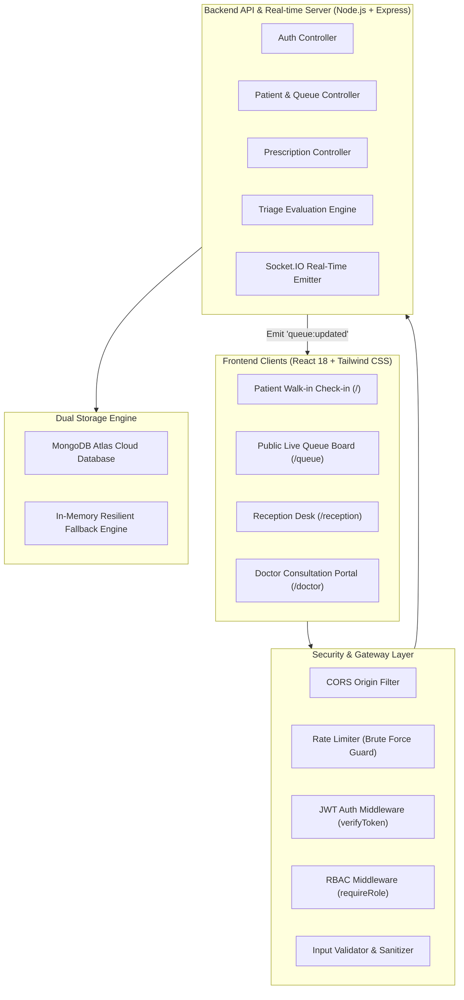

# 🏥 MediTrack: Smart Outpatient Queue & Digital Prescription System

[](https://meditrack-m156.onrender.com)
[](https://github.com/Nidhi-shakya/MediTrack)
[](https://jwt.io/)
[-brightgreen?style=for-the-badge&logo=jest&logoColor=white)](https://jestjs.io/)
[](https://socket.io/)
[](https://nodejs.org/)
[](https://react.dev/)

> **Live Deployment:** [https://meditrack-m156.onrender.com](https://meditrack-m156.onrender.com)  
> **Demo Staff Credentials:** PIN `1234` (Bcrypt verified) • Roles: Receptionist (`reception`) & Doctor (`doctor`)

---

## 📌 Problem Statement & Objectives

### Problem Statement
In community outpatient clinics and regional primary health centers (PHCs), manual paper-based token queues create overcrowding, arbitrary wait times, lack of emergency prioritization, and exposed patient medical confidentiality. Physical paper prescriptions are prone to loss, handwriting misinterpretations, and lack audit history.

### Project Objectives
1. **Algorithmic Outpatient Triage:** Automatically prioritize critical cases (e.g. chest pain, high fever in seniors) over routine checkups.
2. **Patient Data Privacy (HIPAA / DISHA Principles):** Mask names (e.g. `Ramesh S.`) and strictly omit phone numbers and clinical symptoms from public waiting room screens.
3. **Real-Time Queue Streaming:** Deliver sub-second queue status updates across Reception, Doctor Cabin, and Public Display via **Socket.IO** without page refreshes.
4. **Enterprise Role-Based Security:** Prevent unauthorized prescription issuance by receptionists or queue tampering through cryptographically signed **JSON Web Tokens (JWT)** and **Bcrypt** hashed credentials.
5. **Zero-Downtime Reliability:** Dual storage architecture seamlessly connecting to MongoDB Atlas with an automatic in-memory failover fallback.

---

## 🏗️ System Architecture



---

## 🔒 Security Architecture & Role-Based Access Control (RBAC)

### 1. Authentication Layer
- **Cryptographic Signing:** Signed using `jsonwebtoken` (HMAC-SHA256) with dynamic secure runtime fallback.
- **Credential Storage:** Staff PINs and passwords are never stored in plain text; all credentials are encrypted using `bcryptjs` with 10 salt rounds.
- **Brute Force Protection:** Login endpoint `/api/auth/login` is protected with `express-rate-limit` (15 requests per 15 min window).
- **Session Lifecycle:** Tokens expire in 8 hours (`JWT_EXPIRES_IN=8h`). The client context automatically catches `TOKEN_EXPIRED` (HTTP 401), clears storage, and redirects to the sign-in modal.

### 2. Authorization Permission Matrix

| Endpoint | Method | Public | Receptionist | Consulting Doctor | Purpose |
|---|:---:|:---:|:---:|:---:|---|
| `/api/patients/public-queue` | `GET` | ✅ Allowed (Masked) | ✅ Allowed | ✅ Allowed | Privacy-safe live queue board |
| `/api/patients` | `POST` | ✅ Allowed | ✅ Allowed | ✅ Allowed | Register appointment & triage |
| `/api/auth/login` | `POST` | ✅ Allowed | ✅ Allowed | ✅ Allowed | Bcrypt verify PIN & return JWT |
| `/api/patients` | `GET` | ❌ 401 Blocked | ✅ Allowed (Full Data) | ✅ Allowed (Full Data) | Full clinical patient roster |
| `/api/patients/call-next` | `POST` | ❌ 401 Blocked | ✅ Allowed | ✅ Allowed | Call next highest-urgency token |
| `/api/patients/:id` | `PUT` | ❌ 401 Blocked | ✅ Allowed | ✅ Allowed | Advance consultation status |
| `/api/patients/:id` | `DELETE`| ❌ 401 Blocked | ✅ Allowed | ❌ 403 Forbidden | Remove record from queue |
| `/api/prescriptions` | `POST` | ❌ 401 Blocked | ❌ 403 Forbidden | ✅ Allowed | Issue official Rx and complete |
| `/api/prescriptions` | `GET` | ❌ 401 Blocked | ✅ Allowed | ✅ Allowed | Review digital Rx archive |
| `/api/prescriptions/patient/:id` | `GET` | ❌ 401 Blocked | ❌ 403 Forbidden | ✅ Allowed | View patient Rx consultation history |

---

## 🗄️ Database Schemas & Optimization

### Mongoose Models & Compound Indexes
- **Patient Schema (`models/Patient.js`):**
  - Fields: `tokenNumber`, `name`, `age`, `gender`, `phone`, `temperature`, `symptoms`, `priority`, `riskScore`, `status`, `prescription`.
  - Indexes:
    - `{ status: 1, priority: 1, createdAt: 1 }` (Fast priority queue sorting).
    - `{ tokenNumber: 1 }` (Unique token retrieval).
    - `{ name: 1 }` (Search indexing).
- **Prescription Schema (`models/Prescription.js`):**
  - Fields: `patientId`, `patientName`, `tokenNumber`, `doctorName`, `diagnosis`, `medicines: [{ medicineName, dosage, duration }]`, `notes`, `doctorNotes`, `followUpDate`.
  - Indexes: `{ patientId: 1, createdAt: -1 }` (Fast patient history queries).
- **Staff Schema (`models/Staff.js`):**
  - Fields: `username`, `name`, `role`, `passwordHash`, `isActive`.

---

## 🧬 Automated Smart Triage & Clinical Decision-Support

### Priority Rules
- 🔴 **High Priority (Priority 1, 85% Estimated Risk Score):** Triggered if **Age $\ge 65$** OR **Temperature $\ge 102^\circ\text{F}$** OR **Acute Red-Flag Symptoms** (*chest pain, shortness of breath, acute numbness*). Sequenced to the head of the queue.
- 🟡 **Medium Priority (Priority 2, 50% Estimated Risk Score):** Triggered if **Age $\ge 50$** OR **Temperature $\ge 100^\circ\text{F}$**.
- 🟢 **Normal Priority (Priority 3, 15% Estimated Risk Score):** Standard routine outpatient checkup sequenced sequentially.

### ⚠️ Decision-Support Disclaimer
> *"MediTrack Automated Smart Triage is an algorithmic decision-support tool developed strictly for queue prioritization and educational demonstration. It is NOT a clinically validated diagnostic device or medical diagnosis. Attending physicians retain sole clinical responsibility for patient assessments. For acute emergency symptoms, call emergency services (112 / 102) immediately."*

---

## 🧪 Automated Test Suite (Jest + Supertest)

**41 automated test cases passed across 5 test suites (100% pass rate):**

```bash
# Execute the test suite
cd backend
npm test
```

```text
PASS tests/auth.test.js (6 tests)
  ✓ should authenticate reception staff with valid PIN and return JWT
  ✓ should authenticate doctor with valid PIN and return JWT
  ✓ should reject login with incorrect PIN (401 Unauthorized)
  ✓ should reject login request when PIN/password is missing (400 Bad Request)
  ✓ should return current verified user profile on GET /api/auth/me with valid JWT
  ✓ should reject GET /api/auth/me when token is omitted (401 Unauthorized)

PASS tests/authorization.test.js (8 tests)
  ✓ should allow receptionist to access GET /api/patients
  ✓ should allow doctor to access GET /api/patients
  ✓ should block unauthenticated requests to GET /api/patients with 401
  ✓ should block receptionist from creating prescriptions with 403 Forbidden
  ✓ should allow doctor to create a digital prescription (201 Created)
  ✓ should block receptionist from fetching digital prescriptions with 403 Forbidden
  ✓ should allow doctor to fetch digital prescriptions (200 OK)
  ✓ should block non-admin staff from deleting patient records with 403 Forbidden

PASS tests/privacy_and_patients.test.js (12 tests)
  ✓ should allow anyone to view public queue without authentication
  ✓ should mask patient names in the public queue
  ✓ should NOT expose phone numbers or symptoms in the public queue
  ✓ should reject patient registration when required fields are missing (400 Bad Request)
  ✓ should reject patient registration when phone number is invalid (400 Bad Request)
  ✓ should allow authenticated receptionist to register a patient with sequential token
  ✓ should return full unmasked patient details for authenticated staff
  ✓ should allow updating patient status
  ✓ should prioritize Emergency patients ahead of Normal patients
  ✓ should automatically call the next highest priority waiting patient (POST /call-next)
  ✓ should support search query parameter on GET /api/patients
  ✓ should support pagination on GET /api/patients

PASS tests/prescriptions.test.js (6 tests)
  ✓ should reject prescription creation when diagnosis or medicines are missing
  ✓ should allow a doctor to generate and store a digital prescription
  ✓ should retrieve the generated prescription for the patient
  ✓ should return 404 when querying prescription for non-existent patient
  ✓ should support followUpDate and doctorNotes in prescription issuance
  ✓ should retrieve prescription history for specific patient via GET /api/prescriptions/patient/:patientId

PASS tests/triage.test.js (7 tests)
  ✓ should classify chest pain as Emergency priority with red flag
  ✓ should classify high fever as Urgent priority
  ✓ should classify routine symptoms as Normal priority
  ✓ should include emergency medical advisory when red flags are present
  ✓ should include non-clinical decision support disclaimer
  ✓ should correctly calculate estimated wait times based on priority and queue position
  ✓ should calculate zero wait time for currently consulting patient

Test Suites: 5 passed, 5 total
Tests:       41 passed, 41 total
Snapshots:   0 total
Time:        22.698 s
```

---

## ⚙️ Environment Variables (`backend/.env.example`)

```env
# Server Port & Mode
PORT=5000
NODE_ENV=production

# JWT Signing Key
JWT_SECRET=replace_with_a_secure_random_string_in_production
JWT_EXPIRES_IN=8h

# MongoDB Cloud Connection (Optional - defaults to In-Memory Fallback)
MONGODB_URI=mongodb+srv://<username>:<password>@cluster0.mongodb.net/meditrack?retryWrites=true&w=majority

# Staff Credentials
RECEPTION_PIN=1234
DOCTOR_PIN=1234

# Allowed Client Origin
CLIENT_URL=https://meditrack-m156.onrender.com
```

---

## 🚀 Execution Commands

```bash
# Clone
git clone https://github.com/Nidhi-shakya/MediTrack.git
cd MediTrack

# Install Dependencies
npm --prefix backend install
npm --prefix frontend install

# Build Frontend Bundle
npm --prefix frontend run build

# Run Automated Tests
npm --prefix backend test

# Start Production Server (serves API & Frontend on http://localhost:5000)
npm --prefix backend start
```

---

## 🎓 MCA Project Viva Preparation & Key Workflows

### 1. Explain the Authentication & Authorization Flow
- **Authentication:** When a staff member inputs their PIN, the server looks up the staff profile and executes `bcrypt.compare()`. If valid, the server creates a signed JWT containing `{ id, username, role, name }` with a expiration of 8 hours.
- **Authorization:** On protected requests, `authenticateToken` parses `Authorization: Bearer <token>`, verifies the HMAC-SHA256 signature, and attaches `req.user`. Then `requireRole(['doctor'])` checks whether the user's role matches the required clearance. If not, it halts the request with `HTTP 403 Forbidden`.

### 2. How is Patient Privacy Protected?
- When the live queue board fetches data from `/api/patients/public-queue`, the backend passes all records through `storage.maskPatientName()` (`Ramesh Sharma` $\rightarrow$ `Ramesh S.`) and deletes the `phone` and `symptoms` keys from the JSON response before sending it to the client. Full details are only provided on `/api/patients` when accompanied by a valid staff JWT.

### 3. How do Real-time Updates Work without Page Refreshes?
- When a patient books an appointment, a receptionist advances queue status, or a doctor completes a consultation, the backend invokes `io.emit('queue:updated')`. The React client's Socket.IO listener intercepts this event and calls `fetchPublicQueue()` and `fetchPatients()`, updating the state smoothly in real time across all open tabs.
